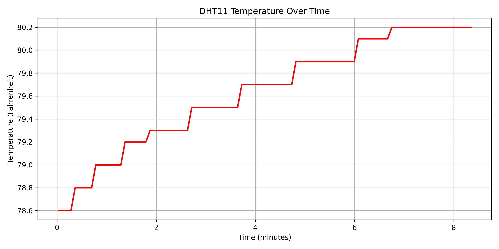
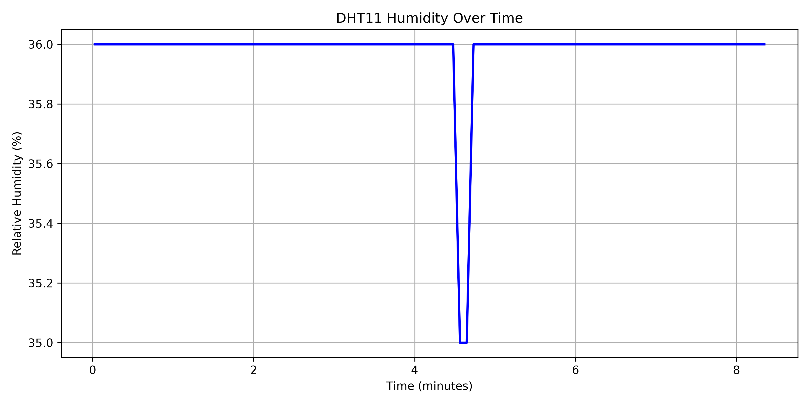

# DHT11 Temperature & Humidity Monitor

An Arduino Uno project that measures temperature and humidity using a DHT11 sensor and displays the readings on a 16x2 LCD. The system displays humidity, temperature in Celsius, and temperature in Fahrenheit.

The project also includes CSV data logging and Python-based data analysis to visualize temperature and humidity measurements over time.

## Features

- Measures temperature using a DHT11 sensor
- Measures relative humidity
- Converts temperature from Celsius to Fahrenheit
- Displays live readings on a 16x2 LCD
- Outputs sensor readings to the Arduino Serial Monitor
- Updates readings every 5 seconds
- Logs up to 100 temperature and humidity measurements at 5-second intervals
- Analyzes recorded sensor data using Python
- Calculates average, minimum, and maximum temperature and humidity
- Generates temperature and humidity graphs using matplotlib

## Components

- Arduino Uno R3
- DHT11 temperature and humidity sensor
- LCD1602 16x2 display
- 10k potentiometer
- Breadboard
- Jumper wires

## Wiring

### DHT11

| DHT11 Pin | Arduino Connection |
|---|---|
| VCC | 5V |
| DATA | Digital Pin 7 |
| GND | GND |

### LCD1602

| LCD Pin | Function | Arduino Connection |
|---|---|---|
| 1 | VSS | GND |
| 2 | VDD | 5V |
| 3 | VO | Potentiometer |
| 4 | RS | Digital Pin 12 |
| 5 | RW | GND |
| 6 | E | Digital Pin 11 |
| 7–10 | D0–D3 | Not Connected |
| 11 | D4 | Digital Pin 5 |
| 12 | D5 | Digital Pin 4 |
| 13 | D6 | Digital Pin 3 |
| 14 | D7 | Digital Pin 2 |
| 15 | A | 5V |
| 16 | K | GND |

The potentiometer is connected between 5V and GND, with the center pin connected to the LCD VO pin to control the display contrast.

## Required Libraries

### Arduino Libraries

- DHT sensor library by Adafruit
- Adafruit Unified Sensor
- LiquidCrystal

The DHT libraries can be installed through the Arduino IDE Library Manager. LiquidCrystal is included with the Arduino IDE.

### Python Libraries

- pandas
- matplotlib

Install the Python libraries using:

`python -m pip install pandas matplotlib`

## How It Works

The DHT11 measures the current temperature and humidity. The Arduino reads these values and converts the Celsius temperature to Fahrenheit using:

`F = (C × 9 / 5) + 32`

The readings are then displayed on the LCD in the following format:

```text
Humidity: 32%
C:24.8 F:76.6
```

The same sensor readings are also sent to the Serial Monitor at 9600 baud.

## Data Logging

The Arduino logs up to 100 temperature and humidity measurements at 5-second intervals. Each measurement is sent to the Serial Monitor in CSV format.

Each reading includes:

- Reading number
- Time since Arduino startup (milliseconds)
- Temperature in Celsius (°C)
- Temperature in Fahrenheit (°F)
- Relative humidity (%)

A sample dataset containing 100 measurements is available in the `sample_data(1).csv` file in this repository.

After 100 measurements, data logging stops, but the LCD continues displaying live temperature and humidity readings.

## Python Data Analysis

The 100 recorded sensor measurements were analyzed using Python, pandas, and matplotlib.

The `AnalyzeData.py` script reads the CSV dataset, calculates temperature and humidity statistics, and generates graphs showing how the measurements change over time.

Temperature analysis is performed in Fahrenheit, while humidity is measured as relative humidity (%).

### Temperature Over Time



### Humidity Over Time



### Results

| Measurement | Average | Minimum | Maximum |
|---|---|---|---|
| Temperature (°F) | 79.63°F | 78.60°F | 80.20°F |
| Relative Humidity (%) | 35.98% | 35.00% | 36.00% |

### Observations

- Temperature gradually increased from 78.6°F to 80.2°F over approximately 8.3 minutes.
- Relative humidity remained mostly constant at 36%.
- Two measurements briefly dropped to 35% humidity before returning to 36%.
- The temperature increased by 1.6°F during the recording period.
- The collected data demonstrates how Python can be used to analyze and visualize measurements from an Arduino-based sensor system.

### Running the Python Analysis

1. Install Python on your computer.
2. Install the required Python libraries:

   `python -m pip install pandas matplotlib`

3. Download or clone this repository.
4. Open the project folder in Visual Studio Code or another Python development environment.
5. Run the analysis script:

   `python AnalyzeData.py`

The script displays summary statistics in the terminal and saves both graphs to the `images` folder.

No Arduino connection is required to run the Python analysis because the recorded measurements are already stored in the CSV file.

## Running the Arduino Project

1. Connect the DHT11 and LCD1602 to the Arduino using the wiring tables above.
2. Install the required Arduino libraries through the Arduino IDE.
3. Open `DHT11_Temperature_Humidity_Sensor.ino`.
4. Select the correct Arduino board and COM port.
5. Upload the program to the Arduino Uno.
6. The LCD will begin displaying temperature and humidity readings.
7. Optionally, open the Serial Monitor and set the baud rate to `9600` to view the measurements.
8. To save the recorded data, copy the CSV output from the Serial Monitor into a `.csv` file.

## Project Photos

### Completed Project


### Full Circuit


### LCD Display


## Limitations

- The DHT11 sensor has limited accuracy compared to more advanced temperature and humidity sensors.
- The system only measures temperature and humidity in its immediate surroundings.
- The Arduino logs a maximum of 100 measurements per run.
- Measurements are sent through the Serial Monitor and must be saved manually to keep a permanent record.
- The system requires a power source to operate.

## Future Improvements

Possible future improvements include:

- Adding additional environmental sensors
- Saving measurements automatically to an SD card
- Adding wireless monitoring using Wi-Fi or Bluetooth
